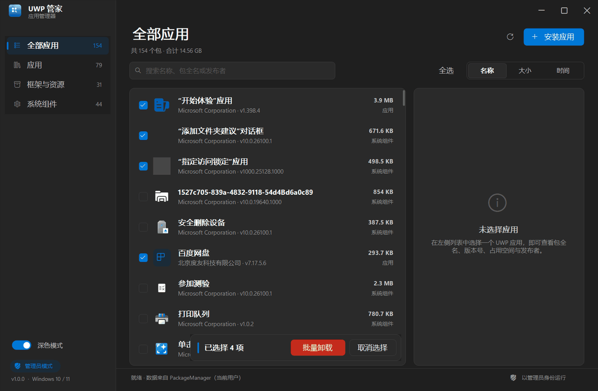
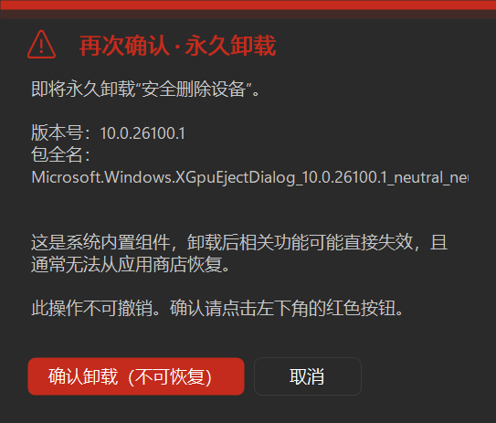
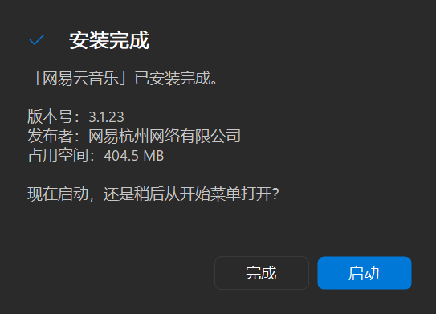
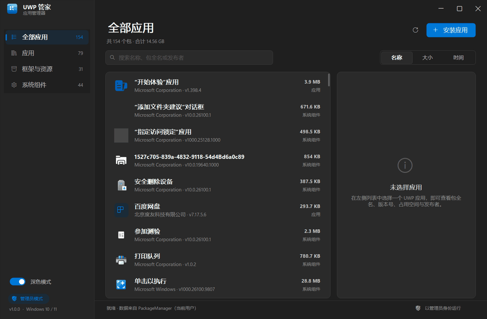
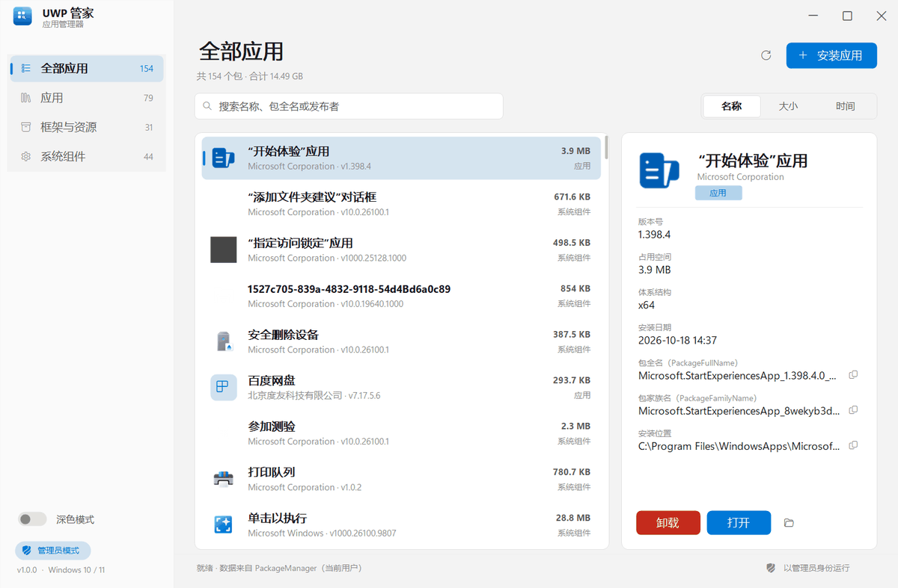

# UWP 管家（UWP Manager）

一个 Fluent Design 风格的本机 UWP / MSIX 应用检测与管理工具。

## 下载

- 直接可运行的单文件：`UwpManager.exe`（24.6 MB，内含 WinRT 投影，需 .NET 10 桌面运行时）
- 压缩发布包：`UwpManager-1.0.0-win-x64.zip`（约 6.2 MB）

> 仓库只存源码，编译产物不放 git；二进制通过 GitHub Releases 分发。
## 单文件便携版

**`dist\UwpManager.exe` 就是全部** —— 一个 24.6 MB 的 exe，绿色免安装，双击即用，不写注册表、不建快捷方式、不留文件（除运行日志外）。

- 启动时自动请求管理员权限（卸载 / 安装 UWP 需要）
- 自带应用图标，任务栏、Alt+Tab、资源管理器都正常显示
- 换个文件夹、拷到 U 盘都能用，不需要重新配置

### 运行环境

需要**已安装 .NET 10 桌面运行时**（本机已具备，`dotnet --list-runtimes` 中可见 `Microsoft.WindowsDesktop.App 10.x`）。
如果拷到没装的电脑，系统会弹窗提示并给出下载链接（.NET 10 Desktop Runtime，x64）。

> 需要“完全免运行时”的版本也可以用一条命令自制，见文末「构建」。

### ⚠️ 关于当前这个文件夹

`…\空闲工作区\UWP软件` 这个目录被系统安全策略锁死：**任何** exe 在里面都无法取得应用包信息
（`0x80070005`），也无法向目录外写文件。这与是否管理员无关，实测（ACL 改写、计划任务、PowerShell 子进程）
都会被拒，程序无法绕过。

因此：**把 exe 放在这个目录之外即可**。已经在桌面放了一份可直接用的副本：
`C:\Users\Administrator\Desktop\UwpManager.exe`

若在工作区内双击，程序会提示「当前文件夹被系统安全策略锁定，请复制到桌面或其他文件夹」。`dist\UwpManager.exe`
与桌面那份完全相同，作为源码仓库内的存档。

## 功能

| 功能 | 说明 |
| --- | --- |
| 应用检测 | 读取当前用户全部 UWP / MSIX 包，按「应用 / 框架与资源 / 系统组件」分类 |
| 详细信息 | 名称、包全名（PackageFullName）、包家族名、版本号、开发厂商、体系结构、安装日期、安装位置、实际占用空间 |
| 多选 | 默认不显示复选框；点工具栏「选择」进入多选模式后每行才出现复选框（按钮变为「完成」）。模式内点击行即勾选，`Shift+点击` 连续选，`Ctrl+A` 或「全选」一键全选，底部浮出「已选择 N 项」操作条 |
| 批量卸载 | 勾选多个后点「批量卸载」：同样两步确认（第二次红色警示 + 按钮在左下），逐个执行并给出「成功 N 个 / 失败 M 个」结果清单 |
| 卸载 | **两步确认**：第一次常规确认（按钮在右下），第二次是红色警示框（顶部红条 + 红色标题，主按钮改到**左下角**并改为「确认卸载（不可恢复）」，防止连点误操作）；系统组件 / 框架包同样可以尝试卸载，由系统最终裁决 |
| 安装 | 文件选择框支持**多选**，一次装多个包（自动先装普通包再装 bundle），逐个执行并显示 `(3/5)` 进度 |
| 安装完成 | 弹出提示框，可点「启动」直接打开或点「完成」关闭 |
| 启动 / 定位 | 打开应用或在资源管理器中定位安装目录 |
| 复制 | 包全名、家族名、安装路径一键复制 |
| 搜索 / 排序 | 按名称、包全名、发布者搜索；按名称 / 大小 / 安装时间排序 |
| 主题 | 跟随系统深色/浅色，左下角可手动切换 |

**多选与批量操作：**



**卸载二次确认（醒目标识 + 按钮换位）：**



**安装完成：**



### 快捷键

| 键 | 作用 |
| --- | --- |
| `Ctrl+F` | 聚焦搜索框 |
| `Ctrl+O` | 安装应用包 |
| `F5` | 刷新列表与体积 |
| `Delete` | 卸载选中应用；若已勾选多个则执行批量卸载（列表有焦点时） |
| `Space` | 勾选 / 取消勾选当前行 |
| `Ctrl+A` | 全选 / 取消全选（列表有焦点时） |
| `Enter` / 双击 | 启动选中应用 |

## 截图





## 源码与构建

```
src/UwpManager/          主程序（WinForms + Windows SDK 投影，net10.0-windows10.0.19041.0）
  Program.cs             入口、单实例、崩溃日志到 %TEMP%\UwpManager-error.log
  Theme.cs               配色 / 字体 / 圆角 / 明暗主题
  Native.cs              Win32 互操作（无边框窗口、圆角、暗色模式）
  AppxService.cs         包枚举、体积统计、安装、卸载、启动
  Models.cs              AppPackage 模型与搜索匹配
  Ui/FluentWindow.cs     无边框 + 原生阴影 / 缩放 / 贴靠
  Ui/Controls.cs         按钮、搜索框、导航、分段控件、开关
  Ui/PackageList.cs      虚拟化列表
  Ui/DetailPane.cs       详情卡片
  Ui/InfoDialog.cs       消息 / 确认 / 进度对话框
  Ui/MainForm.cs         主窗口与业务流程
  Assets/app.ico         应用图标
tools/make_icon.py       图标生成（Pillow）
tools/testpkg/           自建测试 UWP 包（验证安装/卸载，可安全删除）
tools/SmokeTest/         无界面冒烟测试（直接调用 AppxService）
```

### 单文件便携版（当前产物）

```powershell
dotnet publish src/UwpManager/UwpManager.csproj -c Release -r win-x64 `
  --self-contained false -p:PublishSingleFile=true -o build/publish
# 产物：build/publish/UwpManager.exe（约 24.6 MB，需 .NET 10 桌面运行时）
```

### 完全自包含（免 .NET 运行时，约 53 MB）

```powershell
dotnet publish src/UwpManager/UwpManager.csproj -c Release -r win-x64 `
  --self-contained true -p:PublishSingleFile=true `
  -p:IncludeNativeLibrariesForSelfExtract=true -p:EnableCompressionInSingleFile=true -o build/publish-sc
```

> 注意：完全自包含的单文件版本在本工作区目录内**无法启动**（系统拦截了运行时解包），
> 请放到桌面等普通目录使用。

### 图标

`python tools/make_icon.py` 重新生成 `Assets/app.ico`（多尺寸 16–256）。

## 已验证的行为

- 用自建测试包 `UwpManager.SmokeTest`（`tools/testpkg`，自签名 .msix）跑通完整链路：
  - 安装 → 列表出现该包（名称 / 包全名 / 版本 / 体积 30.5 KB）
  - 卸载 → 列表恢复、`Get-AppxPackage` 确认已移除
- 搜索匹配：`microsoft` 137 条、`网易` 1 条、无效词 0 条
- 深色 / 浅色主题切换、确认对话框、安装文件选择框均正常
- 便携版在桌面与 `C:\Temp` 下均可直接启动并读取 154 个包

## 已知限制

- 仅枚举**当前用户**已安装的包（`FindPackagesForUser`）
- 系统组件、框架包、资源包不允许卸载（按钮置灰）
- 安装时不做依赖自动解析，缺依赖会提示先装 `Dependencies` 里的框架包（`0x80073CF3`）
- 未做代码签名，拷到其他电脑首次运行可能触发 SmartScreen 提示（选“仍要运行”）
- 仅提供 x64 构建；ARM64 把 `-r win-x64` 换成 `-r win-arm64` 重新发布即可
